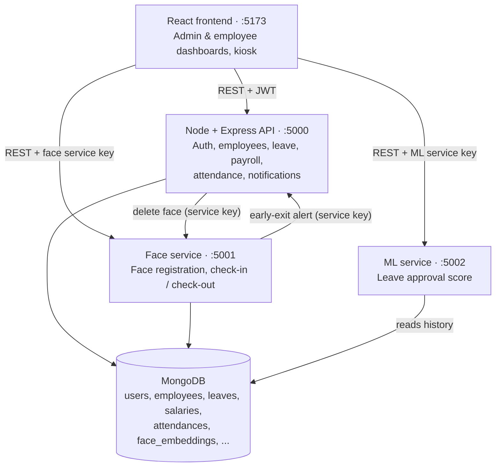
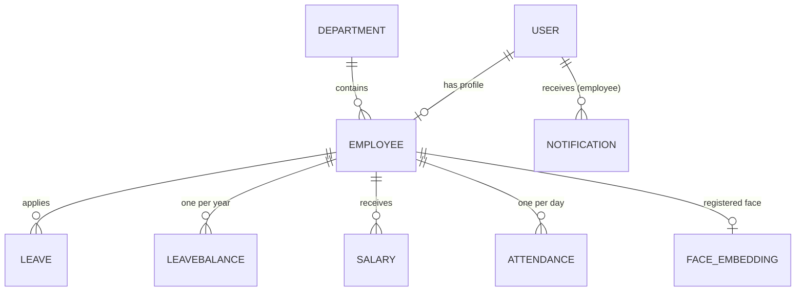
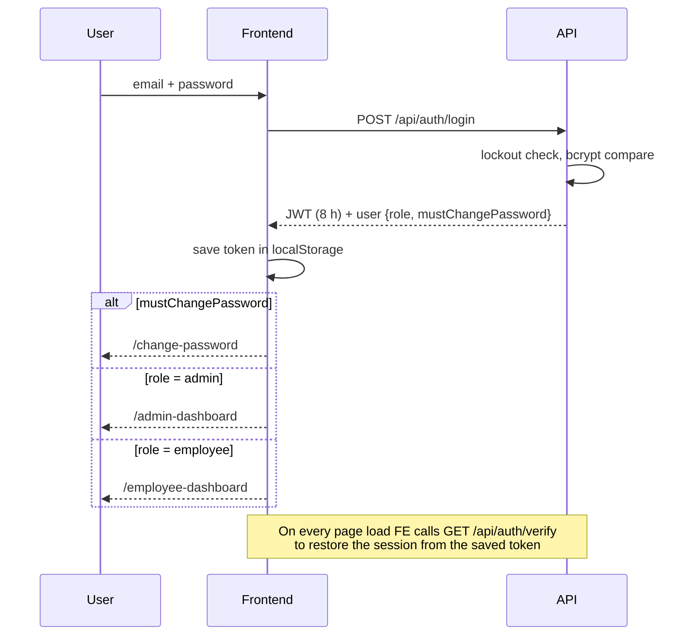
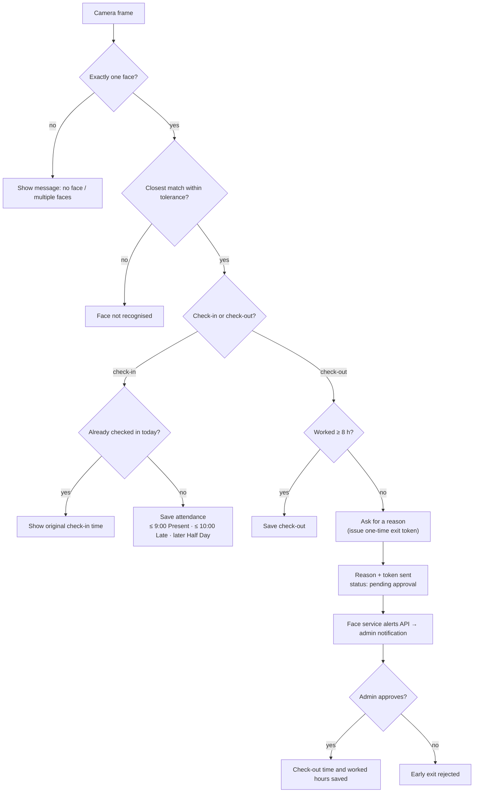
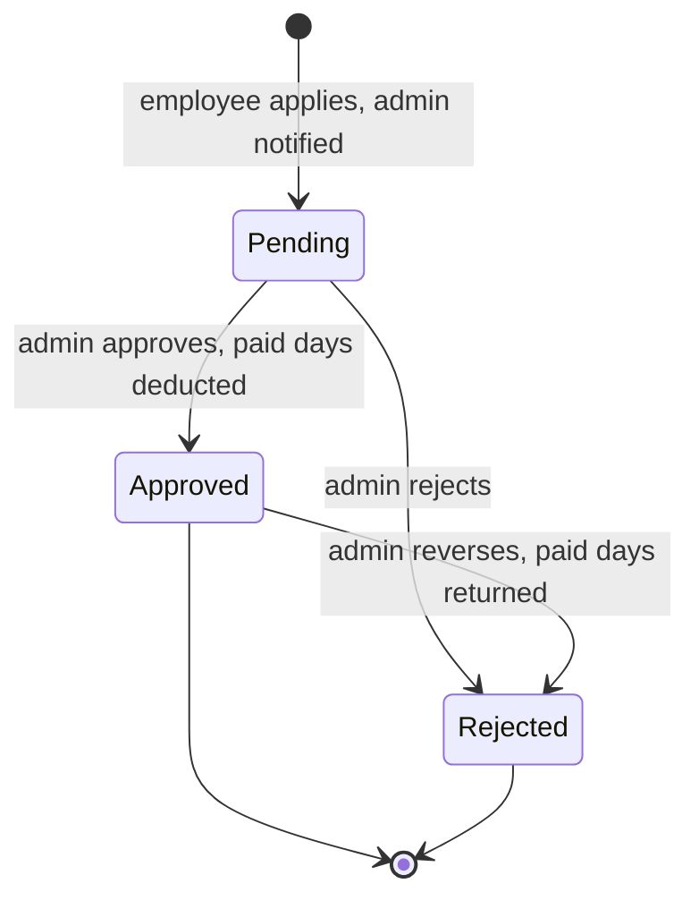
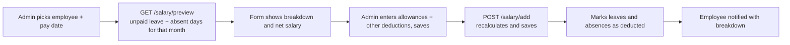

# EMS — Technical Documentation

EMS (Employee Management System) is a web-based HR platform for a small organisation. It connects **face-recognition attendance**, a **policy-driven leave system** and **payroll**, so that attendance and leave feed directly into salary. An **ML service** scores each leave request to support the admin's decision.

This document explains what the system does, how it is built, how its parts work together, and how to install, run, maintain and extend it.

---

## Contents

1. [Overview](#1-overview)
2. [Technology stack](#2-technology-stack)
3. [Architecture](#3-architecture)
4. [Project structure](#4-project-structure)
5. [Data model](#5-data-model)
6. [Authentication and authorization](#6-authentication-and-authorization)
7. [Modules and workflows](#7-modules-and-workflows)
8. [API reference](#8-api-reference)
9. [Frontend](#9-frontend)
10. [Installation and configuration](#10-installation-and-configuration)
11. [Testing](#11-testing)
12. [Error handling](#12-error-handling)
13. [Security](#13-security)
14. [Limitations and future improvements](#14-limitations-and-future-improvements)
15. [Maintaining and extending](#15-maintaining-and-extending)

---

## 1. Overview

### What it does

| Area | Summary |
|---|---|
| **Employees and departments** | Admin creates departments and employees (with photo). Each employee gets a login account. |
| **Face attendance** | A shared office screen (kiosk) checks people in and out by face. Status (Present / Late / Half Day) is set automatically. Leaving before 8 hours needs admin approval. |
| **Leave** | Employees apply for Annual, Casual or Sick leave. The system checks the company rules, counts only working days, and splits each request into paid and unpaid days. |
| **ML leave prediction** | For each request, the admin sees a 0–100 approval score with an explanation of how it was reached. |
| **Payroll** | Admin adds monthly salary. Unpaid leave and absent days are deducted automatically. |
| **Holidays** | Admin declares holidays; they are excluded from leave counts and absence deductions. |
| **Notifications** | In-app notifications for leave, salary, holidays, absences and early-exit requests. |

### Who uses it

| User | Where | What they do |
|---|---|---|
| **Admin** | Admin dashboard | Manages people, approves leave and early exits, runs payroll, declares holidays |
| **Employee** | Employee dashboard | Applies for leave; views own attendance, salary, balance and notifications |
| **Anyone at the office** | Attendance kiosk (`/attendance`) | Checks in and out by face, with no login |

---

## 2. Technology stack

| Layer | Technology | Why it is used |
|---|---|---|
| Frontend | **React 19**, **Vite** | Component-based UI; Vite gives fast development and small production builds |
| Styling | **Tailwind CSS 3** (via PostCSS) | Utility classes keep styling consistent without separate CSS files |
| Routing | **React Router 7** | Separate admin and employee areas with nested routes and route guards |
| HTTP client | **Axios** | Calls the API and Python services; attaches the login token |
| Tables / icons | **react-data-table-component**, **react-icons** | Sortable, paginated tables (leave, departments); icon set |
| API | **Node.js**, **Express 5** | REST API for all business logic |
| Database | **MongoDB** with **Mongoose 9** | Flexible documents; schemas, references and hooks for cascading deletes |
| Auth | **jsonwebtoken**, **bcrypt** | Stateless login tokens; secure password hashing |
| Uploads | **Multer** | Employee photo upload, saved to `server/public/uploads` |
| Email | **Nodemailer** (Gmail SMTP) | Welcome email with login details for new employees |
| Face service | **Python, Flask**, **face_recognition** (dlib), **OpenCV**, **NumPy** | Face detection and 128-number face encodings for matching |
| ML service | **Python, Flask**, **scikit-learn**, **pandas**, **joblib** | Random Forest model training and prediction |
| Python ↔ DB | **PyMongo** | Both Python services read and write the same MongoDB database |
| Tests / CI | **Node test runner** (`node --test`), **GitHub Actions** | Rule tests with no extra packages; run automatically on every push |

---

## 3. Architecture

EMS is four independent services around one MongoDB database.



| Service | Folder | Responsibility | Talks to |
|---|---|---|---|
| Frontend | `frontend/` | All screens; routes users by role | API, face service, ML service |
| API | `server/` | Business rules, auth, data access, notifications, email | MongoDB, face service |
| Face service | `python_services/face_service/` | Stores face encodings; marks check-in / check-out directly in MongoDB | MongoDB, API |
| ML service | `python_services/ml_service/` | Trains and serves the leave approval model | MongoDB (read only) |

**How the services communicate**

- **Frontend → API:** every request carries `Authorization: Bearer <JWT>`.
- **Frontend → Python services:** requests carry an `X-Service-Key` header (`VITE_FACE_SERVICE_KEY` / `VITE_ML_SERVICE_KEY`).
- **Face service → API:** sends early-exit alerts to `/api/attendance/notify-early-exit` with the face service key.
- **API → face service:** removes a deleted employee's face data via `/delete-face/:employeeId`.
- **Shared database:** the face service writes `attendances` and `face_embeddings`; the ML service reads `employees`, `departments`, `leaves` and `attendances`.

---

## 4. Project structure

```
EMS/
├── frontend/
│   ├── index.html               Single HTML page (React mounts here)
│   └── src/
│       ├── App.jsx              Routes (pages load on demand)
│       ├── context/authContext  Logged-in user, token check, logout
│       ├── pages/               Login, dashboards, attendance kiosk, forced password change
│       ├── components/
│       │   ├── dashboard/       Navbar (notification bell), sidebar, summary, salary breakdown, email settings
│       │   ├── employee/        List, add, edit, view (profile)
│       │   ├── department/      List, add, edit
│       │   ├── leave/           Apply, history, admin table, detail (+ ML score), balances
│       │   ├── salary/          Add salary, salary history
│       │   ├── attendance/      Admin view, employee view, face registration, holidays
│       │   ├── notifications/   "View all" page + shared helpers
│       │   └── ConfirmModal, AlertPopup, Pagination, PageLoader
│       └── utils/               API/service config, route guards, leaveDays, usePagination
├── server/
│   ├── index.js                 Express app, CORS, routes, error handler
│   ├── db/db.js                 MongoDB connection
│   ├── models/                  Mongoose schemas (9 collections)
│   ├── controllers/             Logic per module
│   ├── routes/                  URL → middleware → controller
│   ├── middleware/              authMiddleware, adminMiddleware, serviceKeyMiddleware
│   ├── utils/                   hrRules (core rules), workdays, emailService
│   ├── tests/                   Automated rule tests
│   ├── public/uploads/          Employee photos (not committed)
│   └── userSeed.js              Creates the first admin
├── python_services/
│   ├── face_service/app.py      Face API
│   └── ml_service/
│       ├── app.py               ML API (trains on first run if no model)
│       ├── build_dataset_v2.py  Builds the training CSVs from the raw dataset
│       ├── evaluate_model.py    Accuracy, confusion matrix, classification report
│       └── leave_model.pkl      Trained model
└── .github/workflows/tests.yml  CI: runs server tests on every push
```

---

## 5. Data model



| Collection | Key fields | Notes |
|---|---|---|
| `users` | name, email (unique), password (bcrypt), role (`admin`/`employee`), profileImage, mustChangePassword | Login accounts |
| `employees` | userId → users, employeeId (unique code), dob, gender, maritalStatus, designation, department → departments, salary | HR profile |
| `departments` | dep_name, description | Deleting one removes its employees and all their data (Mongoose `pre('deleteOne')` hook) |
| `leaves` | employeeId, leaveType, startDate, endDate, **days** (working days), reason, status (`Pending`/`Approved`/`Rejected`), paidDays, unpaidDays, salaryDeduction, deductionApplied | `deductionApplied` stops a deduction being used twice |
| `leavebalances` | employeeId, year, annualLeave / sickLeave / casualLeave `{total, used, remaining}`, unpaidDays | Unique per employee + year; created on first use |
| `salaries` | employeeId, basicSalary, allowances, deductions (total), netSalary, payDate, otherDeductions, leaveDeduction, absentDays, absentDeduction | Breakdown fields exist on newer records |
| `attendances` | employeeId, date (`YYYY-MM-DD`), checkIn/checkOut, workedMinutes, lateMinutes, status (`Present`/`Late`/`Half Day`/`Absent`/`Holiday`/`Weekend`), earlyExit fields, markedBy, salaryDeducted | Unique per employee + date |
| `holidays` | name, date (`YYYY-MM-DD`, unique), description | |
| `notifications` | type, message, link, forRole (`admin`/`employee`/`all`), forUserId, isRead, readBy, dismissedBy, actionable, actionStatus, attendanceId | `readBy` / `dismissedBy` track broadcasts per employee |
| `face_embeddings` | employeeId (code), employeeName, encoding (128 numbers) | Written by the face service |

---

## 6. Authentication and authorization

### Login flow



### Rules

| Mechanism | Where | Behaviour |
|---|---|---|
| **Password hashing** | `bcrypt` | Passwords are never stored in plain text |
| **JWT** | `authController`, `authMiddleware` | Signed with `JWT_KEY`, valid 8 hours; the middleware loads the user from the database on every request |
| **Login lockout** | `authController` | 5 wrong passwords for an email within 10 minutes locks that email for 15 minutes (kept in memory, resets on server restart) |
| **Forced password change** | Login page | New accounts must change their password before using the dashboard |
| **Admin-only routes** | `adminMiddleware` (`verifyAdmin`) | Returns 403 unless `req.user.role === 'admin'` |
| **Data ownership** | Controllers | Employees only get their own profile, leaves, balance, salary, attendance and notifications; IDs and roles come from the token, never from the URL or body |
| **Service keys** | `serviceKeyMiddleware`, Python `require_service_key` | Calls between services must carry the matching `X-Service-Key` |
| **Frontend guards** | `PrivateRoutes`, `RoleBaseRoutes` | Redirect to `/login` or `/unauthorized`; for user experience only, as the server enforces the real rules |

---

## 7. Modules and workflows

### 7.1 Employees and departments

- **Add employee** (admin): creates a `users` account (hashed password, `mustChangePassword: true`) and an `employees` profile. The photo is uploaded through Multer (JPG/PNG/WEBP/GIF, max 5 MB). Duplicate emails and employee IDs are rejected. If SMTP is configured, a welcome email with the login details is sent.
- **Delete employee**: removes the face encoding (via the face service), the login, leaves, salaries, attendance, balances and personal notifications.
- **Delete department**: deletes every employee in it, with all of the data above.

### 7.2 Face attendance

**Registration** (admin → *Register Face*): the admin captures one or more photos (two or more recommended). The face service finds exactly one face per photo (HOG detector), creates encodings, averages them and stores the result in `face_embeddings`. Registration is refused if the face matches another employee within the tolerance (default `0.45`; lower is stricter).

**Check-in / check-out** (kiosk at `/attendance`):



**Absent check** (admin → *Run absent check*): marks every employee without an attendance record today as `Absent`, and notifies the admin for each one. It does nothing on a holiday or weekend (`WEEKEND_DAYS`) and skips employees on approved leave. It runs only when the admin clicks it.

### 7.3 Leave

| Type | Days / year | Max per request | Notice | Gap between requests | Monthly cap |
|---|---|---|---|---|---|
| Annual | 14 | 5 | 7 days | 14 days | — |
| Casual | 6 | 3 | 1 day | 7 days | 3 days (extra days become unpaid) |
| Sick | 8 | — | none | — | — (admin alerted after 3 in 30 days) |

**Validation** (checked live while the employee fills the form, and again on submit):

1. End date after start date; start not in the past.
2. No overlap with another pending or approved leave.
3. At least one working day; weekends and holidays in the range are listed and not counted.
4. Notice period, max per request, and gap rules from the table.
5. Casual monthly cap and the sick-leave frequency alert (these give warnings, not errors).

**Paid / unpaid split:** working days covered by the remaining balance (and, for Casual, the monthly cap) are paid; the rest are unpaid. The unpaid amount is `monthly salary ÷ 26 × unpaid days`, using the latest salary record or else the employee's recorded salary.



At approval the balance is checked again: if other leaves have used it up since submission, the shortfall moves to unpaid, so the balance can never go negative.

### 7.4 ML leave prediction

When the admin opens a leave request, the frontend sends its details to `POST /predict-leave`. The service combines three parts:

| Component | Inputs | Weight: no history → 16+ decisions |
|---|---|---|
| **Random Forest** (300 trees, depth 8) | leave type, duration, month, weekday, previous leaves, department, age, tenure, attendance reliability (% non-absent over the last 90 records) | 55% → 12% |
| **Bayesian personal rate** | the employee's own approve/reject history, starting from a weak 65% prior | 25% → 68% |
| **HR rules** | duration limits per leave type (e.g. Annual: normal 7, max 21) | 20% (fixed) |

The weights shift toward the personal history as it grows, because a person's own track record becomes more reliable than general patterns. A request beyond a hard duration limit is capped at a very low score.

**Output:** score (0–100), verdict (72+ *Likely to be Approved*, 52–71 *Could go either way*, 35–51 *Unlikely*, below 35 *Not Recommended*), each component's contribution, top factors and patterns (e.g. frequent Monday/Friday leaves). The admin still makes the decision.

**Training data:** the UCI *Absenteeism at Work* dataset (740 records), cleaned and bootstrapped to about 7,000 rows by `build_dataset_v2.py`. The model is saved to `leave_model.pkl` (about 80% test accuracy) and retrained through `POST /train`.

### 7.5 Payroll



```
Net = Basic + Allowances − Other deductions − Unpaid leave − Absent days
```

- **Unpaid leave:** approved leaves that start in the pay month and have not been deducted yet.
- **Absent days:** `Absent` records in the pay month that are not on a weekend, a holiday or an approved leave day, at `basic ÷ 26` per day.
- The preview and the saved salary use the same calculation, and each leave or absence is deducted only once.
- Total deductions cannot exceed basic + allowances.

### 7.6 Holidays, notifications, email and dashboard

- **Holidays:** admin adds or deletes them; adding one sends a notification to all employees. Holidays are skipped in leave counts, absence deductions and the absent check.
- **Notifications:** created by the system for leave applied / approved / rejected, sick-leave alerts, salary paid, holidays, absences and early-exit requests and decisions. The bell shows All/Unread tabs grouped by day. Clicking a notification marks it read and opens its link. Users can mark read or unread, delete, and clear all read ones; the *View all* page adds paging. A pending early-exit request cannot be deleted until it is decided. Holiday broadcasts track read and deleted state per employee.
- **Email:** only the welcome email (new employee) and a test email. The admin saves Gmail SMTP details in *Email Settings*, which writes `SMTP_EMAIL` / `SMTP_PASSWORD` to `server/.env`.
- **Dashboard:** total employees and departments, total salary, leave counts by status, and a salary breakdown.

---

## 8. API reference

All API routes start with `/api` and return JSON `{ success, ... }` or `{ success: false, error }`.
**Access:** *Public* = no login · *User* = any logged-in user (own data only for employees) · *Admin* = admin only · *Service* = service key.

| Module | Method & path | Access | Purpose |
|---|---|---|---|
| Auth | `POST /auth/login` | Public | Log in, returns JWT |
| | `GET /auth/verify` | User | Restore session from token |
| Departments | `GET /department` · `GET /department/:id` | User | List / get |
| | `POST /department/add` · `PUT /department/:id` · `DELETE /department/:id` | Admin | Create / update / delete (cascades) |
| Employees | `GET /employee` · `GET /employee/department/:id` | Admin | List all / by department |
| | `GET /employee/:id` | User | Profile (employee: own only) |
| | `POST /employee/add` (multipart) · `PUT /employee/:id` · `DELETE /employee/:id` | Admin | Create / update / delete |
| Leave | `POST /leave/validate` · `POST /leave/add` | User | Check rules / apply (as the logged-in user) |
| | `GET /leave/balance/:userId` | User | Balance (own only) |
| | `GET /leave/:id/:role` · `GET /leave/employee/:empId` · `GET /leave/detail/:id` | User | History / detail (own only) |
| | `GET /leave` · `GET /leave/all-balances` · `PUT /leave/:id` | Admin | All leaves / all balances / approve or reject |
| Salary | `GET /salary/preview/:employeeId?payDate&basic` | Admin | Automatic deductions preview |
| | `POST /salary/add` | Admin | Add salary |
| | `GET /salary/:id/:role` | User | Salary history (own only) |
| Attendance | `GET /attendance/employee/:userId?month&year` | User | Attendance (own only) |
| | `GET /attendance/daily/:date` | Public | Today's list for the kiosk |
| | `GET /attendance/monthly/:year/:month` · `POST /attendance/run-absent-check` · `POST /attendance/early-exit-action` · `POST /attendance/mark` · `POST /attendance/checkout` | Admin | Monthly view / absent check / approve early exit / manual marking |
| | `POST /attendance/notify-early-exit` | Service | Alert from the face service |
| Holidays | `GET /holidays` | User | List |
| | `POST /holidays/add` · `DELETE /holidays/:id` | Admin | Add / delete |
| Notifications | `GET /notifications?page&limit&filter=all\|unread` | User | Paged list + unread count |
| | `PUT /notifications/read/:id` · `PUT /notifications/unread/:id` · `PUT /notifications/read-all` | User | Read state |
| | `DELETE /notifications/:id` · `DELETE /notifications/clear-read` | User | Delete one / clear read |
| Settings | `PUT /setting/change-password` | User | Change own password |
| | `GET/POST /setting/email-config` · `POST /setting/test-email` | Admin | SMTP settings |
| Dashboard | `GET /dashboard/summary` · `/salary-breakdown` · `/salary-all` | Admin | Dashboard data |

**Face service (`:5001`, all except `/health` need the service key):** `GET /health` · `POST /register` `{employeeId, images[]}` · `POST /recognize` `{image}` (check-in) · `POST /checkout` `{image}` or `{employeeId, earlyExitReason, exitToken}` · `DELETE /delete-face/:employeeId` · `GET /list-faces`

**ML service (`:5002`):** `GET /health` (model status, accuracy) · `POST /predict-leave` `{leaveTypeName, leaveDuration, month, dayOfWeek, employeeId, previousLeavesTaken}` · `POST /train` (both need the service key)

---

## 9. Frontend

### Routes

| Path | Access | Page |
|---|---|---|
| `/login` | Public | Login |
| `/attendance` | Public | Face attendance kiosk (today's list refreshes every 30 s) |
| `/change-password` | Logged in | Forced password change |
| `/unauthorized` | Public | Access denied |
| `/admin-dashboard/...` | Admin | Summary, departments, employees (list/add/view/edit/salary), salary add, leaves (table/detail), leave balances, attendance, face registration, holidays, email settings, salary breakdown, notifications, settings |
| `/employee-dashboard/...` | Employee, Admin | Summary, profile, leave history, apply leave, salary, attendance, notifications, settings |

### Key design points

- **Auth state:** `authContext` holds the user, checks the saved token on load (`/auth/verify`) and provides `logout`.
- **Lazy loading:** every page is loaded on demand (`React.lazy` + `Suspense`), which cut the first download from 593 KB to 321 KB.
- **Shared UI:** `ConfirmModal` (confirmations), `AlertPopup` (`showAlert()` replaces browser alerts), `Pagination` + `usePagination` (client-side paging), `PageLoader`.
- **Configuration:** `utils/apiConfig.js` and `utils/serviceConfig.js` read service URLs and keys from `VITE_*` variables, so the same build can point at any environment.
- **Leave days:** `utils/leaveDays.js` shows the stored working-day count, falling back to calendar days for older records.

---

## 10. Installation and configuration

### Requirements

- **Node.js 20+** (the start script uses `--env-file`)
- **Python 3.11** for the face service (`face_recognition` / dlib does not support 3.12+)
- **MongoDB** running locally (default `mongodb://localhost:27017`)

### Environment variables

**`server/.env`**

| Variable | Required | Purpose |
|---|---|---|
| `PORT` | yes | API port (5000) |
| `MONGODB_URL` | yes | e.g. `mongodb://localhost:27017/ems_new` |
| `JWT_KEY` | yes | Secret for signing login tokens (long random string) |
| `FACE_SERVICE_KEY` | recommended | Must match the face service's key |
| `FACE_SERVICE_URL` | no | Default `http://localhost:5001` |
| `ALLOWED_ORIGINS` | no | Comma-separated CORS origins (local network addresses are always allowed) |
| `WEEKEND_DAYS` | no | Weekly off days, `0`=Sun … `6`=Sat, comma-separated; default `6` |
| `ADMIN_EMAIL`, `ADMIN_PASSWORD` | first run | Used once by `userSeed.js` |
| `SMTP_EMAIL`, `SMTP_PASSWORD` | no | Written by *Email Settings*; Gmail App Password |
| `APP_NAME`, `FRONTEND_URL` | no | Name and login link used in the welcome email |

**`python_services/face_service/.env`:** `MONGO_URI`, `DB_NAME` (e.g. `ems_new`), `TOLERANCE` (default `0.45`), `FRONTEND_URL`, `FACE_SERVICE_KEY`, `TIMEZONE` (e.g. `Asia/Kathmandu`), `NODE_SERVER_URL` (default `http://localhost:5000`)

**`python_services/ml_service/.env`:** `MONGO_URI`, `DB_NAME`, `FRONTEND_URL`, `ML_SERVICE_KEY`, `TIMEZONE`, optional `MODEL_PATH`, `CSV_PATH`

**`frontend/.env`** (copy `.env.example`): `VITE_API_URL`, `VITE_FACE_SERVICE_URL`, `VITE_ML_SERVICE_URL`, `VITE_FACE_SERVICE_KEY`, `VITE_ML_SERVICE_KEY`

> The face service key must be the same in the face service, `server/.env` and the frontend. The ML key must match between the ML service and the frontend.

### First-time setup

```bash
# API
cd server
npm install
node userSeed.js            # creates the admin from ADMIN_EMAIL / ADMIN_PASSWORD

# Frontend
cd ../frontend
npm install

# Face service (Python 3.11)
cd ../python_services/face_service
py -3.11 -m venv venv
venv\Scripts\activate
pip install -r requirements.txt
pip install git+https://github.com/ageitgey/face_recognition_models

# ML service
cd ../ml_service
python -m venv venv
venv\Scripts\activate
pip install -r requirements.txt
```

### Running (four terminals, MongoDB running)

| Service | Command | URL |
|---|---|---|
| API | `cd server` → `npm start` | http://localhost:5000 |
| Frontend | `cd frontend` → `npm run dev` | http://localhost:5173 |
| Face service | `cd python_services/face_service` → `venv\Scripts\activate` → `python app.py` | http://localhost:5001 |
| ML service | `cd python_services/ml_service` → `venv\Scripts\activate` → `python app.py` | http://localhost:5002 |

Production build of the frontend: `npm run build` (output in `frontend/dist`).

---

## 11. Testing

The core leave and payroll rules live in `server/utils/hrRules.js` as plain functions. The API uses this file, and the tests check it, so the tests cover the real logic.

```bash
cd server
npm test        # node --test → 22 tests
```

| Group | Tests | Examples |
|---|---|---|
| Dates | 4 | Local-date reading; weekend detection |
| Notice period | 4 | Today = 0 days; Annual needs 7 |
| Working days | 5 | Fri–Sun = 2 days; holidays skipped |
| Paid / unpaid | 4 | 5 days with 2 left = 2 paid + 3 unpaid |
| Salary | 5 | ÷ 26 daily rate; absence rules; net salary formula |

`.github/workflows/tests.yml` runs the same tests on GitHub Actions (Node 22, `TZ=Asia/Kathmandu`) on every push to `main` and on pull requests.

**Other checks:** `npm run lint` (frontend ESLint) and `python evaluate_model.py` (ML accuracy report). Screens, the camera flow and database queries have no automated tests and are checked by hand.

---

## 12. Error handling

| Layer | Approach |
|---|---|
| API | Each controller catches its errors and returns `{ success: false, error }` with 400 (invalid input), 401 (not logged in / expired), 403 (not allowed), 404 (not found), 429 (login locked) or 500. A final Express handler returns clean JSON, never stack traces. Unknown routes return 404 JSON. |
| Validation | Leave rules return a list of `errors` (blocking) and `warnings` (shown, not blocking). Uploads reject wrong file types and files over 5 MB with a clear message. |
| Frontend | Errors from the API are shown in-app through `showAlert()` or inline form messages. An expired token sends the user back to login. |
| Face service | Clear messages for no face, multiple faces, unknown face, duplicate registration, already checked in or out. |
| ML service | Returns 400 for non-numeric inputs; falls back to an average if the model is unavailable. |
| Email | Sending failures do not block actions; e.g. an employee is still created, with a note that the email was not sent. |

---

## 13. Security

- Passwords are hashed (bcrypt); there are no plain-text credentials in code. The admin seed reads from `.env`.
- Authorization is enforced on the server: admin-only routes, and employees limited to their own data.
- Login lockout and short-lived tokens (8 h).
- Service keys between services; early checkout without a face scan needs a one-time token.
- CORS allows only configured origins and local-network addresses.
- Uploads are limited to images under 5 MB.
- `.env` files, uploads, `venv` and `node_modules` are git-ignored.

---

## 14. Limitations and future improvements

| Limitation | Impact | Suggested improvement |
|---|---|---|
| Kiosk service keys are bundled into the frontend | Anyone who opens the kiosk can read them; run it on a trusted office machine | Separate kiosk login or device token |
| `/attendance/daily/:date` is public | Today's attendance list is visible on the network | Protect it with the kiosk login |
| Forced password change is checked only in the frontend | Could be bypassed with direct API calls | Enforce it in `authMiddleware` |
| Absent check is manual | Can be forgotten, or run on a day nobody scanned | Scheduled daily job (e.g. `node-cron`) |
| Login lockout is in memory | Resets when the server restarts | Store attempts in MongoDB or Redis |
| Token stored in `localStorage` | Exposed if a script-injection bug ever existed | HTTP-only cookies |
| Leave across two months is deducted in its start month | Monthly split is off; the total is correct | Split deductions by month |
| No balance carry-over | Unused leave is lost at year end | Optional carry-over rule |
| Lists are paged in the browser | Fine for small teams; slow for thousands of records | Server-side pagination |
| No API or UI tests | Regressions outside the core rules are found by hand | API tests with a test database; UI tests |

---

## 15. Maintaining and extending

| Task | Where to change |
|---|---|
| Change leave limits (balance, notice, gap, caps) | `POLICY` in `server/controllers/leaveController.js`; yearly totals in `server/models/LeaveBalance.js` |
| Add a leave type | `POLICY`, the `leaveType` enum in `models/Leave.js`, a balance field in `LeaveBalance.js`, the apply form and filters in the frontend, and `LT_MAP` / `DURATION_LIMITS` in the ML service |
| Change the weekend | `WEEKEND_DAYS` in `server/.env` |
| Change the daily rate (÷ 26) | `WORK_DAYS_PER_MONTH` in `server/utils/hrRules.js`, then update the tests |
| Change attendance times or the 8-hour rule | `checkin_on_time`, `checkin_late_max`, `REQUIRED_HOURS` in `face_service/app.py` |
| Make face matching stricter or looser | `TOLERANCE` in the face service `.env` |
| Add an API endpoint | Controller function → route in `server/routes/` with `authMiddleware` (+ `verifyAdmin` if admin-only) → call it from the frontend with `API_BASE` |
| Add a page | Component in `frontend/src/components/` → lazy route in `App.jsx` → sidebar link |
| Add a notification type | Add it to the `type` enum in `models/Notification.js`, call `createNotification(...)`, and add an icon in `notificationShared.jsx` |
| Retrain the ML model | Update `hr_leave_dataset_clean.csv` (or run `build_dataset_v2.py`), then `POST /train`, and check with `evaluate_model.py` |

**Before committing:** run `npm test` in `server` and confirm the app still builds (`npm run build` in `frontend`).
